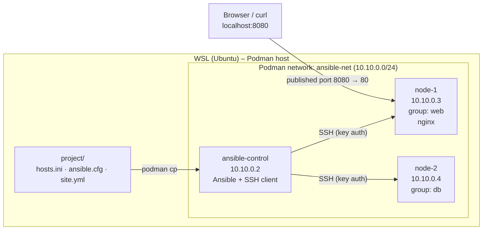

# 🧪 Ansible Podman Lab

A lightweight, fully local **Ansible practice lab** that runs on **WSL (Ubuntu)** using **rootless Podman** containers.
One container acts as the **Ansible control node**, and two containers act as **managed nodes** reached over SSH.

No VMs and no cloud account are needed. The whole lab starts in seconds and can be rebuilt at any time.

---

## 📑 Table of Contents

- [Architecture](#-architecture)
- [Repository Structure](#-repository-structure)
- [Prerequisites](#-prerequisites)
- [Quick Start](#-quick-start)
- [Step-by-Step Setup](#-step-by-step-setup)
- [Inventory](#-inventory)
- [Ad-hoc Commands](#-ad-hoc-commands)
- [Playbooks](#-playbooks)
- [Why nginx?](#-why-nginx)
- [Testing nginx](#-testing-nginx)
- [Viewing nginx in a Browser](#-viewing-nginx-in-a-browser)
- [Daily Workflow](#-daily-workflow)
- [Recreating a Node Safely](#-recreating-a-node-safely)
- [Git Workflow](#-git-workflow)
- [Troubleshooting](#-troubleshooting)
- [Lessons Learned](#-lessons-learned)
- [Security Notes](#-security-notes)
- [Cleanup](#-cleanup)
- [Roadmap](#-roadmap)

---

## 🏗 Architecture



| Container         | Image             | IP          | Role                        | Group | Published port |
|-------------------|-------------------|-------------|-----------------------------|-------|----------------|
| `ansible-control` | `ansible-control` | `10.10.0.2` | Control node (runs Ansible) | –     | –              |
| `node-1`          | `ansible-node`    | `10.10.0.3` | Managed node (nginx)        | `web` | `8080 → 80`    |
| `node-2`          | `ansible-node`    | `10.10.0.4` | Managed node                | `db`  | –              |

**Design choices**

- **Podman network, not a pod.** Containers in a pod share one IP, so per-container static IPs require a network.
- **Ubuntu 22.04 images.** Small, familiar, and use `apt`.
- **`vagrant` user (UID 1000)** in every container, with passwordless `sudo`.
- **Files are edited on the host** (tracked by Git) and copied into the control container. Nothing important lives only inside a container.

---

## 📁 Repository Structure

```text
ansible-podman-lab/
├── Dockerfile.control   # Control node image: Ubuntu + Ansible (pip) + SSH client
├── Dockerfile.node      # Managed node image: Ubuntu + Python + sshd
├── start-lab.sh         # Creates the network and (re)creates the 3 containers
├── setup-ssh.sh         # Generates the control node key and copies it to the nodes
├── stop-lab.sh          # Stops or removes the lab
├── project/             # Ansible content (copied into the control container)
│   ├── ansible.cfg      # Default settings (inventory path, host key checking)
│   ├── hosts.ini        # Inventory: groups, IPs, connection variables
│   └── site.yml         # First playbook: nginx on web, hostname check on db
├── .gitignore           # Keeps private keys out of Git
└── README.md
```

---

## ✅ Prerequisites

| Requirement        | Version used   | Check                       |
|--------------------|----------------|-----------------------------|
| Windows with WSL 2 | –              | `wsl -l -v` (in PowerShell) |
| Ubuntu on WSL      | 22.04 / 24.04  | `lsb_release -a`            |
| Podman (rootless)  | 4.9.3          | `podman --version`          |
| Git                | any recent     | `git --version`             |

Install Podman if needed:

```bash
sudo apt update && sudo apt install -y podman git
```

> ℹ️ Ubuntu does **not** create a `podman` group, and rootless Podman doesn't need one.
> Rootless Podman does need sub-UID/GID ranges. Check with:
> `grep "^$(id -un):" /etc/subuid /etc/subgid`

> ℹ️ The warning `"/" is not a shared mount` is harmless for this lab.

> 💡 Keep the project in your Linux home (e.g. `~/projects/`), **not** under `/mnt/c/`.
> The Windows drive is slow from WSL and causes permission problems for SSH keys and `ansible.cfg`.

---

## 🚀 Quick Start

```bash
git clone <your-repo-url> ansible-podman-lab
cd ansible-podman-lab
chmod +x *.sh

# 1. Build images
podman build -t ansible-control -f Dockerfile.control .
podman build -t ansible-node    -f Dockerfile.node .

# 2. Start the lab (network + 3 containers + copy project files)
./start-lab.sh

# 3. Set up passwordless SSH from control to nodes
./setup-ssh.sh

# 4. Run Ansible
podman exec -it ansible-control bash -c "cd ~/ansible && ansible all -m ping"
podman exec -it ansible-control bash -c "cd ~/ansible && ansible-playbook site.yml"

# 5. Test nginx
curl -s http://localhost:8080 | head -5
```

> If image builds fail with `short-name "ubuntu:22.04" did not resolve`, use the full name:
> `sed -i 's|^FROM ubuntu:22.04|FROM docker.io/library/ubuntu:22.04|' Dockerfile.*`

---

## 🔧 Step-by-Step Setup

<details>
<summary><b>1. Build the images</b></summary>

```bash
podman build -t ansible-control -f Dockerfile.control .
podman build -t ansible-node    -f Dockerfile.node .
podman images | grep ansible
```

**Control image** (`Dockerfile.control`): installs `python3-pip`, `openssh-client`, and `sudo`, creates the `vagrant` user, installs Ansible with `pip --user`, and runs as `vagrant` by default.

**Node image** (`Dockerfile.node`): installs `python3` (required by Ansible modules) and `openssh-server`, creates `vagrant` **with password `vagrant`** (needed once for `ssh-copy-id`), generates SSH host keys, and runs `sshd -D` in the foreground so the container stays up.

Verify Ansible is installed:

```bash
podman run --rm ansible-control ansible --version
```
</details>

<details>
<summary><b>2. Create the network and start the containers</b></summary>

`./start-lab.sh` does this for you. Manually:

```bash
podman network create --subnet 10.10.0.0/24 ansible-net

podman run -d --network ansible-net --ip 10.10.0.2 --name ansible-control --hostname ansible-control ansible-control sleep infinity
podman run -d --network ansible-net --ip 10.10.0.3 -p 8080:80 --name node-1 --hostname node-1 ansible-node
podman run -d --network ansible-net --ip 10.10.0.4 --name node-2 --hostname node-2 ansible-node

podman ps
```

> The control container needs `sleep infinity`. Its default command is `bash`, which exits immediately when run detached.
</details>

<details>
<summary><b>3. Set up passwordless SSH</b></summary>

`./setup-ssh.sh` does this for you. Manually, inside the control container:

```bash
podman exec -it ansible-control bash      # you are already the vagrant user, do NOT run "su - vagrant"

mkdir -p ~/.ssh && chmod 700 ~/.ssh
ssh-keygen -t ed25519 -f ~/.ssh/id_ed25519 -N ""
sudo apt-get update && sudo apt-get install -y sshpass

sshpass -p vagrant ssh-copy-id -i ~/.ssh/id_ed25519.pub -o StrictHostKeyChecking=no vagrant@10.10.0.3
sshpass -p vagrant ssh-copy-id -i ~/.ssh/id_ed25519.pub -o StrictHostKeyChecking=no vagrant@10.10.0.4

ssh vagrant@10.10.0.3 hostname   # → node-1
ssh vagrant@10.10.0.4 hostname   # → node-2
```

The private key **never leaves the control container**.
</details>

<details>
<summary><b>4. Copy the Ansible project into the control container</b></summary>

```bash
podman exec ansible-control mkdir -p /home/vagrant/ansible
podman cp project/. ansible-control:/home/vagrant/ansible/
podman exec --user root ansible-control chown -R vagrant:vagrant /home/vagrant/ansible
```
</details>

---

## 📋 Inventory

`project/hosts.ini`

```ini
[web]
node1 ansible_host=10.10.0.3

[db]
node2 ansible_host=10.10.0.4

[all:vars]
ansible_user=vagrant
ansible_python_interpreter=/usr/bin/python3
ansible_ssh_private_key_file=~/.ssh/id_ed25519
```

| Setting | Purpose |
|---------|---------|
| `[web]`, `[db]` | Groups you can target, e.g. `ansible web ...` |
| `ansible_host` | Real address. `node1` is only a label |
| `[all:vars]` | Variables applied to every host |
| `ansible_ssh_private_key_file` | Resolved **inside the control container** (`~` = `/home/vagrant`) |

`project/ansible.cfg`

```ini
[defaults]
inventory = hosts.ini
host_key_checking = False
```

Ansible reads `ansible.cfg` from the **current directory**, so always run commands from `~/ansible` in the container.

```bash
ansible-inventory --graph
```

---

## ⚡ Ad-hoc Commands

Format: `ansible <hosts|group> -m <module> -a "<args>"`. Without `-m`, the `command` module is used.

| Command | What it does |
|---------|--------------|
| `ansible all -m ping` | Connectivity + Python check → `pong` |
| `ansible all -a "hostname"` | Run a command on every node |
| `ansible web -a "uptime"` | Target one group |
| `ansible db -a "df -h /"` | Disk usage on node2 |
| `ansible all -b -a "whoami"` | `-b` = become (sudo) → `root` |
| `ansible all -m setup -a "filter=ansible_distribution*"` | Gather facts |
| `ansible web -b -m apt -a "name=curl state=present"` | Install a package |

---

## 📜 Playbooks

`project/site.yml`

```yaml
---
- name: Install nginx on the web host
  hosts: web
  become: true
  tasks:
    - name: Install nginx
      apt:
        name: nginx
        state: present
        update_cache: yes

    - name: Start nginx
      service:
        name: nginx
        state: started

- name: Simple hostname test on the db host
  hosts: db
  tasks:
    - name: Run hostname
      command: hostname
      register: out
      changed_when: false

    - name: Show result
      debug:
        msg: "DB host reports {{ out.stdout }}"
```

Run it twice:

```bash
ansible-playbook site.yml    # first run: changed > 0
ansible-playbook site.yml    # second run: changed=0 (idempotent)
```

**Why `changed_when: false`?** The `command` module always reports `changed`, because Ansible can't know whether a command modified anything. `hostname` only reads information, so this line tells Ansible it never changes the system.

> ℹ️ The containers don't run systemd, so `systemctl` doesn't work inside them.
> Ansible's `service` module falls back to the classic `service` command.

---

## 🌐 Why nginx?

nginx is in the lab **because the first playbook (`project/site.yml`) installs it**. It's a practice target, not something the host needs.

```yaml
- name: Install nginx on the web host
  hosts: web          # → node1 (10.10.0.3)
  become: true
  tasks:
    - name: Install nginx
      apt: ...
    - name: Start nginx
      service: ...
```

A web server is a common first example because it practises the core playbook skills (installing a package, starting a service, using `become`) and gives a result you can **see**.

Only **node-1** has nginx. It isn't installed on the WSL host, Windows, the control node, or node-2.

---

## 🧪 Testing nginx

Run these from the WSL host, in the project folder.

### Test 1: Is the service running? (inside node-1)

```bash
podman exec node-1 service nginx status
```

Expected: `* nginx is running`

### Test 2: Does it serve a web page? (from the control node)

This is the realistic test, since it goes over the network like a real client:

```bash
podman exec -it ansible-control bash -c "cd ~/ansible && ansible localhost -m uri -a 'url=http://10.10.0.3'"
```

Look for `"status": 200`. This uses Ansible's `uri` module because the control image doesn't include `curl`.

To see the actual HTML:

```bash
podman exec ansible-control python3 -c "import urllib.request; print(urllib.request.urlopen('http://10.10.0.3').read().decode()[:300])"
```

You should see the start of the **"Welcome to nginx!"** page.

### Test 3: Check it with an ad-hoc command

```bash
podman exec -it ansible-control bash -c "cd ~/ansible && ansible web -b -a 'service nginx status'"
```

### Test 4: Change the page with Ansible

Replace the default page, then fetch it:

```bash
podman exec -it ansible-control bash -c "cd ~/ansible && \
  ansible web -b -m copy -a \"content='<h1>Hello from Ansible on node1</h1>' dest=/var/www/html/index.html\" && \
  ansible localhost -m uri -a 'url=http://10.10.0.3 return_content=yes'"
```

The output's `content` field should show your `<h1>` message. This is the idea behind the **templates** topic on the roadmap.

---

## 🖥 Viewing nginx in a Browser

The containers use **rootless** Podman, so their `10.10.0.x` IPs are **only reachable from other containers**, not from WSL or Windows. To reach nginx from outside, node-1 **publishes port 8080** (`-p 8080:80`). `start-lab.sh` already includes this.

After running the playbook:

- **WSL:** `curl -s http://localhost:8080 | head -5`
- **Windows browser:** open `http://localhost:8080`

Check that the port is published:

```bash
podman port node-1      # → 80/tcp -> 0.0.0.0:8080
```

> If it works in WSL but not in Windows, use the WSL IP instead:
> run `hostname -I` in WSL, then browse to `http://<that-IP>:8080`.

---

## 🔁 Daily Workflow

```text
Edit in WSL  →  podman cp into container  →  run Ansible in container  →  git commit & push from WSL
```

| Task | Where | Command |
|------|-------|---------|
| Get the latest changes (incl. GitLab web edits) | WSL | `git pull --rebase` |
| Start lab after a restart (keeps SSH keys) | WSL | `podman start ansible-control node-1 node-2` |
| Re-start nginx after a restart | WSL | rerun the playbook (see below) |
| Edit files | WSL | `nano project/site.yml` or `code .` |
| Sync files into the container | WSL | `podman cp project/. ansible-control:/home/vagrant/ansible/` |
| Open a shell on the control node | WSL | `podman exec -it ansible-control bash` then `cd ~/ansible` |
| Run a playbook | Container | `ansible-playbook site.yml` |
| Save progress | WSL | `git add . && git commit -m "..." && git push` |

**Rule of thumb:** `podman` and `git` commands run in **WSL**. `ansible` commands run **in the container**. If you see `podman: command not found`, you're inside a container; type `exit`.

> 💡 The containers don't run systemd, so nginx **won't start automatically** after `podman start node-1`.
> Just rerun the playbook; it starts nginx again. That's idempotency in action.

> ⚠️ `./start-lab.sh` **recreates** all containers, which deletes the SSH key and installed packages.
> Run `./setup-ssh.sh` and the playbook again afterwards. Use `podman start ...` for a normal restart.

---

## ♻️ Recreating a Node Safely

When a node is removed and recreated with the **same IP**, two things go stale in the control container:

1. **Network cache:** the old MAC address is remembered, so SSH **times out**.
2. **SSH host key:** the node has a new key, so SSH refuses with **`REMOTE HOST IDENTIFICATION HAS CHANGED`**.

Recreate a node like this (example: node-1):

```bash
podman rm -f node-1
podman run -d --network ansible-net --ip 10.10.0.3 -p 8080:80 --name node-1 --hostname node-1 ansible-node

podman restart ansible-control      # clears the stale network cache (keeps the SSH key)
./setup-ssh.sh                      # clears old host keys and copies the key again
podman cp project/. ansible-control:/home/vagrant/ansible/
podman exec -it ansible-control bash -c "cd ~/ansible && ansible-playbook site.yml"
```

Quick connectivity test (the control image has no `nc` or `telnet`):

```bash
podman exec ansible-control bash -c 'timeout 3 bash -c "</dev/tcp/10.10.0.3/22" && echo "PORT 22 OPEN" || echo "PORT 22 NOT REACHABLE"'
```

---

## 🌿 Git Workflow

One-time identity setup (must match a verified email on your Git server):

```bash
git config --global user.name  "Your Name"
git config --global user.email "your-verified-email@example.com"
```

Everyday:

```bash
git pull --rebase
git status
git add .
git commit -m "Describe what changed"
git push
```

<details>
<summary><b>Syncing edits made on the GitLab/GitHub website</b></summary>

Web edits create a new commit on the server. Bring them down with:

```bash
git pull --rebase
```

If you have uncommitted local changes, commit them first or run `git stash` before pulling and `git stash pop` after.

On a conflict, edit the file to remove the `<<<<<<<`, `=======`, `>>>>>>>` markers, then:

```bash
git add <file>
git rebase --continue
git push
```

Cancel with `git rebase --abort`.
</details>

<details>
<summary><b>Push to both GitLab and GitHub</b></summary>

```bash
git remote add github https://github.com/<user>/ansible-podman-lab.git
git push origin main
git push github main
```

Or push to both with one command:

```bash
git remote set-url --add --push origin <gitlab-url>
git remote set-url --add --push origin <github-url>
git push
```

> ⚠️ Check your organisation's policy before mirroring work-related repositories to a public service.
</details>

<details>
<summary><b>Authentication tips</b></summary>

- **HTTPS:** username + **Personal Access Token** (scope `write_repository` on GitLab, `repo` on GitHub). Tokens are shown only once when created.
- **SSH:** `ssh-keygen -t ed25519`, add `~/.ssh/id_ed25519.pub` to your profile, test with `ssh -T git@<host>`.
- Never use `sudo` with `git` or `ssh`, because it uses root's keys and config.
- Cache HTTPS credentials in memory: `git config --global credential.helper 'cache --timeout=28800'`
</details>

---

## 🛠 Troubleshooting

### Setup and containers

| Symptom | Cause | Fix |
|---------|-------|-----|
| `usermod: group 'podman' does not exist` | Ubuntu doesn't create it | Not needed for rootless Podman. Skip it |
| `--ip` rejected with `podman pod` | Pod containers share one IP | Use `podman network create` + `--network` |
| `ansible-control` not in `podman ps` | Exited (no `sleep infinity`) or never created | `podman ps -a`, then recreate with `sleep infinity` |
| `podman: command not found` | You're inside a container | `exit` back to the WSL host |
| `./setup-ssh.sh: No such file or directory` | Script not in the repo, or wrong folder | `cd` into the project; create the script if missing |

### SSH and Ansible

| Symptom | Cause | Fix |
|---------|-------|-----|
| `su - vagrant` asks for a password | Control image already runs as `vagrant` | Skip `su`. Run commands directly |
| `~/.ssh` missing in control container | Key never generated, or container recreated | `./setup-ssh.sh` |
| `no such identity: ... id_ed25519` | Same as above | `./setup-ssh.sh` |
| `ssh-copy-id`: `Permission denied` | Node image built before the password fix | `grep chpasswd Dockerfile.node`; rebuild `ansible-node`, recreate nodes |
| `port 22: Connection timed out` | Node recreated; control has a stale network cache | `podman restart ansible-control` |
| `REMOTE HOST IDENTIFICATION HAS CHANGED` | Node recreated with a new host key | `./setup-ssh.sh` (clears old keys), or `podman exec ansible-control ssh-keygen -R <ip>` |
| `UNREACHABLE ... publickey` | Key missing on control node or nodes | `./setup-ssh.sh` |
| `UNREACHABLE ... No route to host` | Node stopped | `podman start node-1 node-2` |
| `provided hosts list is empty` | Not in `~/ansible` | `cd ~/ansible` |
| `Missing sudo password` | Node lacks `NOPASSWD` sudo | Rebuild `ansible-node` |

### nginx

| Symptom | Cause | Fix |
|---------|-------|-----|
| `nginx is not running` | Container restarted (no systemd, so services don't auto-start) | Rerun the playbook, or `podman exec node-1 service nginx start` |
| `Connection refused` on port 80 | nginx stopped | Same as above |
| `curl localhost:8080` refused | nginx not running, or port not published | Rerun the playbook; check `podman port node-1` |
| `localhost:8080` doesn't load in Windows | WSL localhost forwarding disabled | Browse to `http://<WSL-IP>:8080` (`hostname -I`) |

### Git

| Symptom | Cause | Fix |
|---------|-------|-----|
| Push rejected: `Author ... is not a member` | Commit email isn't a verified account email | Set `user.email`, then `git commit --amend --reset-author --no-edit` |
| `warning: redirecting to ...git/` | Remote URL missing `.git` | `git remote set-url origin <url>.git` |
| `rejected ... fetch first` | Server has commits you don't (e.g. web edits) | `git pull --rebase`, then `git push` |

---

## 🎓 Lessons Learned

- `podman ps` shows only **running** containers. Use `podman ps -a` to see stopped ones.
- A container must run a **foreground** process (`sshd -D`, `sleep infinity`) or it exits.
- Anything created inside a container is lost when it's **removed**. Keep source files on the host and in Git.
- `.ssh` and other dot-folders are hidden. Use `ls -la`.
- Paths in `hosts.ini` are resolved **where Ansible runs**, not where the file is edited.
- Ansible tasks should be **idempotent**: a second run should report `changed=0`. Use `changed_when: false` for read-only commands.
- Rootless container IPs are only reachable from other containers. **Publish ports** (`-p`) to reach a service from the host.
- Without systemd, services **don't auto-start** after a container restart. Rerunning the playbook restores the desired state.
- Recreating a node with the same IP leaves a **stale network cache** and an **old host key** on the control node.
- Git servers may enforce push rules on **commit author email**, separate from authentication.
- Each WSL distribution is a separate Linux system with its own files, users, keys, and containers. Work in **one** environment and use Git as the source of truth.

---

## 🔒 Security Notes

- This is a **local learning lab**. The `vagrant:vagrant` password and `host_key_checking = False` are for convenience only. Never use them on real servers.
- Private keys stay inside the control container and are excluded by `.gitignore` (`id_ed25519*`).
- Port 8080 is published on the host. Stop the lab when you're not using it, especially on shared networks.
- Never commit tokens, passwords, or keys. Check before committing:
  ```bash
  grep -rl "PRIVATE KEY" --exclude-dir=.git . || echo "OK: no private keys"
  git diff --cached --name-only
  ```
- If a secret is ever committed, treat it as compromised: revoke or regenerate it.

---

## 🧹 Cleanup

```bash
./stop-lab.sh           # stop containers (data kept)
./stop-lab.sh --remove  # remove containers + network

podman rmi ansible-control ansible-node   # optional: remove images
```

---

## 🗺 Roadmap

- [x] Control + managed node images
- [x] Podman network with static IPs
- [x] Passwordless SSH
- [x] Inventory and `ansible.cfg`
- [x] Ad-hoc commands
- [x] First playbook (nginx)
- [x] nginx testing and published port 8080
- [ ] Jinja2 template for a custom `index.html`
- [ ] Handlers (restart nginx on config change)
- [ ] Convert nginx play into a role (`ansible-galaxy init roles/webserver`)
- [ ] Variables, `group_vars/` and `host_vars/`
- [ ] `ansible-vault` for secrets
- [ ] Add `node-3` (10.10.0.5) and more groups
- [ ] Linting with `ansible-lint` and `yamllint`
- [ ] CI pipeline (GitLab CI / GitHub Actions)

---

## 📄 License

For personal learning use. Add a license file (e.g. MIT) if you plan to share this publicly.
